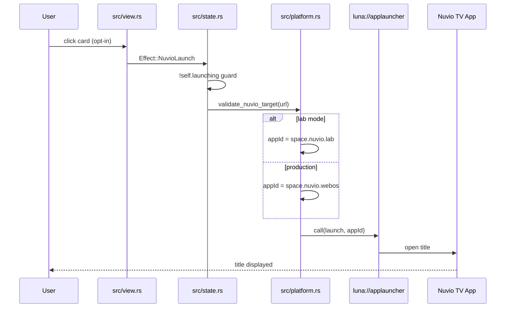
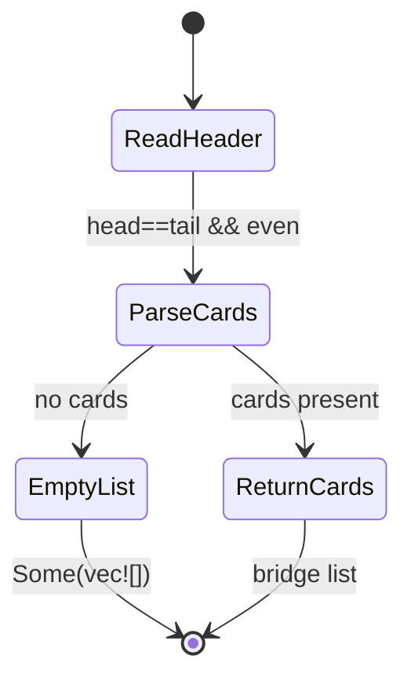

# End-to-End Flows

> ⚡ **BLUF**: Traces the three critical user flows — card click to Nuvio launch,
> LCKV Continue Watching card consumption, and lab target selection — with ASCII
> flow diagrams (terminal/LLM clarity) plus Mermaid diagrams (GitHub web UI).
> Every arrow cites a real `file:line`.

+-----------------------------------------------------------------------------+
| FLOW 1: CARD CLICK → NUVIO LAUNCH (PRODUCTION vs LAB)                       |
+-----------------------------------------------------------------------------+
|                                                                             |
|  [User clicks card]  ──┐                                                    |
|                        v                                                    |
|  [src/state.rs]  Effect::NuvioLaunch                                        |
|                        |  !self.launching guard                            |
|                        v                                                    |
|  [src/platform.rs] validate_nuvio_target(nuvio_url)                         |
|         ┌──────────────┴──────────────┐                                     |
|         |                             |                                     |
|    nuvio_lab=on                   nuvio_lab=off                             |
|    lab=true                       lab=false                                 |
|         |                             |                                     |
|         v                             v                                     |
|  appId = space.nuvio.lab      appId = space.nuvio.webos                     |
|         |                             |                                     |
|         └──────────────┬──────────────┘                                     |
|                        v                                                    |
|  call("luna://com.palmdtv.applauncher/launch")  [src/platform.rs]           |
|                        |                                                    |
|                        v                                                    |
|  [Nuvio TV App] opens title on user opt-in                                  |
|                                                                             |
+-----------------------------------------------------------------------------+
| Never: silent override of production app ID; never modify space.nuvio.webos |
+-----------------------------------------------------------------------------+

+-----------------------------------------------------------------------------+
| FLOW 2: LCKV CONTINUE-WATCHING CARD CONSUMPTION (READ-ONLY)                 |
+-----------------------------------------------------------------------------+
|                                                                             |
|  [LCKV binary file]  ──┐                                                    |
|                        v                                                    |
|  [src/fast_kv.rs] read_bridge_cards(path, collection)  &path = read-only    |
|                        |  seqlock: head == tail && even                    |
|                        v                                                    |
|  cards present? ──no──> Some(vec![])  empty, never synthetic fallback       |
|                        |                                                    |
|                       yes                                                   |
|                        v                                                    |
|  [src/nuvio.rs] bridge_items() → UI card list                               |
|                                                                             |
+-----------------------------------------------------------------------------+

+-----------------------------------------------------------------------------+
| FLOW 3: LAB TARGET SELECTION (ISOLATED TEST, NO PRODUCTION TOUCH)           |
+-----------------------------------------------------------------------------+
|                                                                             |
|  [CI / local macOS]  cargo check --features nuvio,nuvio_lab                 |
|                        |                                                    |
|                        v                                                    |
|  [src/main.rs]  lab_command()  →  nuvio_service(nuvio_lab=true)             |
|                        |                                                    |
|                        v                                                    |
|  appId = space.nuvio.lab   (feature-gated, isolated test target)            |
|                        |                                                    |
|                        v                                                    |
|  webOS IPK build  app id space.nuvio.lab                                    |
|                                                                             |
+-----------------------------------------------------------------------------+

## Mermaid: Full Launch Sequence

## Mermaid: LCKV Bridge Read-Only Lifecycle

