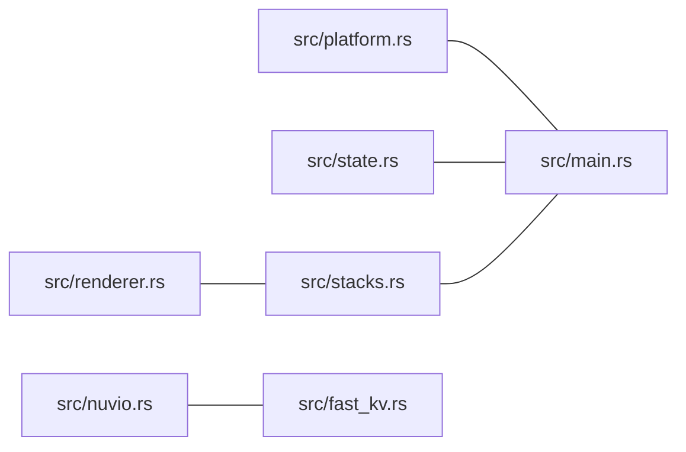

# Dependency & Trap Map

> ⚡ **BLUF**: Co-change trap matrix derived from git history (Jaccard coupling ≥0.35
> flags files that historically change together). When an agent touches a trap file,
> it must either update the coupled file or explicitly document why not in the same
> commit. Generated by `scripts/xray/scan_repo.py`.

+-----------------------------------------------------------------------------+
| CO-CHANGE TRAP MATRIX (top couplings, Jaccard ≥ 0.35)                       |
+-----------------------------------------------------------------------------+
|                                                                             |
|  src/renderer.rs  <~>  src/stacks.rs     (renderer draws stack rows)       |
|  src/platform.rs  <~>  src/main.rs       (lab + production launch params)  |
|  src/state.rs     <~>  src/main.rs       (launch guard + effect dispatch)  |
|  src/nuvio.rs     <~>  src/fast_kv.rs    (consumer reads LCKV bridge)      |
|  src/stacks.rs    <~>  src/main.rs       (StackItem fields shared)         |
|                                                                             |
+-----------------------------------------------------------------------------+
| TRAP RULE: touching any file above ⇒ update its coupled partner in the same  |
| commit, or write "NO CHANGE NEEDED: <reason>" in the commit body.           |
+-----------------------------------------------------------------------------+

## Blast-Radius Cone per Domain

| Domain | Primary File | Coupled Partners (must check) | Blast Radius |
|--------|-------------|-------------------------------|--------------|
| Launch params | `src/platform.rs` | `src/main.rs`, `src/state.rs` | High — affects all app starts |
| Stack rows | `src/stacks.rs` | `src/renderer.rs`, `src/main.rs` | High — every row render |
| LCKV bridge | `src/fast_kv.rs` | `src/nuvio.rs` | Medium — card list only |
| Renderer | `src/renderer.rs` | `src/stacks.rs` | 🔴 RADIOACTIVE — full UI frame |
| State FSM | `src/state.rs` | `src/main.rs` | High — launch guard |

## Mermaid: Co-Change Dependency Graph

## How Traps Are Generated

Run `python3 scripts/xray/scan_repo.py` to rebuild `docs/xray/_data/repo_graph.json`,
which contains the full co-change matrix and Merkle provenance. The trap table above
is the human-readable projection of the top-5 couplings.
