# Hyper-Runner Specification

> ⚡ **BLUF**: A single, deterministic, hardware-aware execution engine (`scripts/hyper_runner.py`)
> plus a zero-I/O RAM scratchpad bootstrapper (`scripts/ram_workspace.sh`) that runs identically on
> Virtual Linux containers and macOS M1 Pro. It skips unchanged tests via a Merkle-AST DAG, packs
> work with Graham's LPT scheduler, sizes workers via MiMo's memory-admission equation, and issues
> tamper-evident Arena Execution Receipts. Zero fabricated metrics — every number is backed by a
> `RCPT-XXXXXXXXXXXX` receipt.

+-----------------------------------------------------------------------------+
| UNIFIED HYPER-RUNNER: VIRTUAL LINUX VM <--> macOS M1 PRO                    |
+-----------------------------------------------------------------------------+
|                                                                             |
|            [1. MERKLE-AST AFFECTED-TEST DAG]                                |
|   Parse changed files -> transitive closure -> skip unchanged (~0.1ms)      |
|                                         |                                   |
|                                         v                                   |
|                    [2. HARDWARE TELEMETRY PROBE (<5ms)]                     |
|                   /                                       \                 |
|        (Linux: cgroup v2)                        (macOS: Mach VM + P/E)     |
|                  /                                           \              |
|                 v                                             v             |
|   +-----------------------------+                 +-----------------------------+  |
|   | VIRTUAL LINUX WORKSPACE     |                 | LOCAL macOS M1 PRO          |  |
|   | • cpu.max / affinity        |                 | • P-cores (Firestorm)       |  |
|   | • memory.max vs current     |                 | • E-cores (Icestorm, 50%)   |  |
|   | • /dev/shm (tmpfs)          |                 | • APFS RAM Disk (clonefile) |  |
|   | • 4 KB pages                |                 | • 16 KB pages               |  |
|   +-------------+---------------+                 +---------------+------------+  |
|                 \                                             /               |
|                  +---------------------+---------------------+                |
|                                         |                                   |
|                                         v                                   |
|           [3. LPT WORK-STEALING SCHEDULER]                                  |
|   Sort by historical duration DESC -> dispatch slowest first, RAM-governed  |
|                                         |                                   |
|                                         v                                   |
|     [4. TAMPER-EVIDENT RECEIPT LEDGER: docs/xray/_data/execution_receipts.json] |
+-----------------------------------------------------------------------------+

## 5-W + H Execution Matrix

| Dimension | Answer | Source |
|-----------|--------|--------|
| **WHAT** | Cross-platform LPT + Merkle-AST test/lab runner | [`scripts/hyper_runner.py`](scripts/hyper_runner.py) |
| **WHY** | Eliminate 70–95% redundant compute; never OOM containers; never fabricate metrics | Council hardware-aware scheduling |
| **WHERE** | `scripts/hyper_runner.py`, `scripts/ram_workspace.sh`, `docs/xray/_data/execution_receipts.json` | File paths above |
| **WHEN** | Stage 2 & Stage 3 of the 5-stage Arena workflow (`AGENTS.md`) | [`AGENTS.md`](AGENTS.md) |
| **WHO** | Arena cloud agent + local macOS agent | Dual-environment |
| **HOW** | Merkle hash → skip-or-run → LPT order → RAM scratchpad → receipt → `arena_guard.py ship` | [`scripts/hyper_runner.py`](scripts/hyper_runner.py) |

## Core Operating Laws (SM-HR-01 → SM-HR-08)

| # | Law | Evidence |
|---|-----|----------|
| SM-HR-01 | Rosetta-2 x86 emulation on M1 Pro is detected and auto-re-executed as native ARM64e | [`scripts/hyper_runner.py`](scripts/hyper_runner.py#L60-L78) `enforce_native_apple_silicon()` |
| SM-HR-02 | Worker count uses real cgroup v2 / Mach telemetry, never naive `os.cpu_count()` | [`scripts/hyper_runner.py`](scripts/hyper_runner.py) `probe_hardware_physics()` |
| SM-HR-03 | All temp/IPC lives in a RAM scratchpad (`/dev/shm` Linux, APFS RAM macOS) | [`scripts/hyper_runner.py`](scripts/hyper_runner.py) `execute_single_test()` + [`scripts/ram_workspace.sh`](scripts/ram_workspace.sh) |
| SM-HR-04 | Unchanged tests skip via Merkle-AST transitive-dependency hash (~0.1ms) | [`scripts/hyper_runner.py`](scripts/hyper_runner.py#L99-L132) `compute_transitive_test_merkle()` |
| SM-HR-05 | Scheduling order is Graham's LPT (longest processing time first) | [`scripts/hyper_runner.py`](scripts/hyper_runner.py#L186-L188) |
| SM-HR-06 | Worker count capped by MiMo's memory-admission equation to prevent Exit-137 OOM | [`scripts/hyper_runner.py`](scripts/hyper_runner.py#L178-L183) |
| SM-HR-07 | Every run issues a tamper-evident `RCPT-XXXXXXXXXXXX` receipt; no fabricated metrics | [`scripts/hyper_runner.py`](scripts/hyper_runner.py#L203-L220) |
| SM-HR-08 | Receipts share the same ledger as `arena_guard.py exec`; `ship` requires a valid green receipt | [`scripts/arena_guard.py`](scripts/arena_guard.py) |

## Mathematical Models

### MiMo's Worker-Sizing Equation (prevents OOM + CPU starvation)

$$W^* = \max\!\left(1,\;\min\!\left(C_{\text{eff}},\;\left\lfloor\frac{M_{\text{budget}} - M_{\text{parent}}}{\hat{\mu}_{\text{worker}} + 1.65\,\hat{\sigma}_{\text{worker}}}\right\rfloor\right)\right)$$

* $C_{\text{eff}}$: Linux = $\min(|\text{sched\_getaffinity}|, \lceil\text{cgroup quota}/\text{period}\rceil)$; M1 Pro = $N_{\text{P-cores}} + \lfloor 0.5 \cdot N_{\text{E-cores}}\rfloor$
* $M_{\text{budget}} = 0.80 \times (M_{\text{max}} - M_{\text{current}})$ (Linux cgroup) or $0.80 \times M_{\text{UMA\_available}}$ (macOS)

### Graham's LPT Makespan Guarantee

LPT achieves within $\frac{4}{3} - \frac{1}{3W^*}$ of the NP-hard optimal makespan in $O(N \log N)$ time, eliminating tail stragglers.

## Mermaid: Merkle-AST Skip Decision

```mermaid
flowchart TD
    A[Test file changed?] -->|No| B[Compute Merkle-AST hash]
    B --> C{Cached hash == current?}
    C -- yes --> D[SKIP test (~0.1ms)]
    C -- no --> E[Execute test]
    E --> F[Record duration + pass/fail]
    F --> G[Update telemetry cache]
    D --> H[Issue RCPT receipt]
    G --> H
```

## Mermaid: LPT Scheduling vs Naive

```mermaid
gantt
    title LPT (Longest Processing Time First) eliminates straggler tail
    dateFormat  X
    axisFormat %s
    section Core 1 (P)
    Slow E2E test (9.5s)  : 0, 9.5
    section Core 2 (P)
    Med test 1 (3s) : 0, 3
    Med test 2 (3s) : 3, 6
    Fast t1..t8     : 6, 6.7
    section Core 3 (P)
    Med test 3 (3s) : 0, 3
    Med test 4 (3s) : 3, 6
    Fast t9..t16    : 6, 6.7
```



## Cross-Platform Scorecard (falsifiable)

| ID | Physical metric | Target SLA | Measured (this repo) |
|----|-----------------|------------|----------------------|
| P1 | Parallel packing efficiency $\sum\text{CPU}/(W^* \times \text{Wall})$ | $\ge 0.85$ | receipt-backed per run |
| P2 | Incremental Merkle skip speed (1 file changed) | $\le 0.80\text{ s}$ | RCPT-2BD83C591889: 0.002 s |
| P3 | Memory safety headroom (peak RSS / container max) | $\le 0.85$, zero OOM | W* RAM-capped |
| P4 | Disk write amplification (bytes to SSD) | $\approx 0$ (RAM I/O) | RAM scratchpads only |
| P5 | Cross-OS result parity (Linux == M1 Pro) | 100% identical pass/fail | same `--runner` semantics |

## Receipts Issued (tamper-evident ledger)

| Receipt | Command | Exit | Env | Wall | Tests | Skipped | Failed |
|---------|---------|------|-----|------|-------|---------|--------|
| RCPT-D8C607171D6B | `hyper_runner --all labs/...` | 0 | Virtual-Linux | 0.082 s | 1 | 0 | 0 |
| RCPT-2BD83C591889 | `hyper_runner labs/...` (warm) | 0 | Virtual-Linux | 0.002 s | 0 | 1 | 0 |

Ledger: [`docs/xray/_data/execution_receipts.json`](docs/xray/_data/execution_receipts.json)
