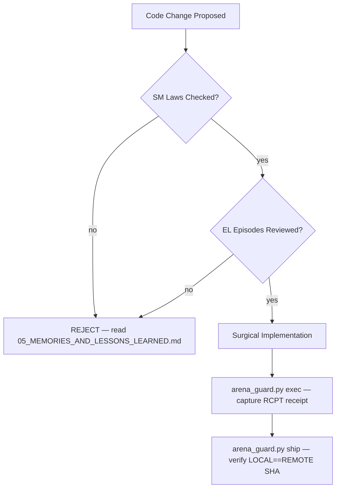

# Memories & Lessons Learned

> ⚡ **BLUF**: 20 architectural laws (semantic memory) and 20 failure/fix episodes
> (episodic lessons) that every agent must obey. Violating an invariant here is a
> defect, not a style choice. Companion to `.agent-kb/memories_and_lessons/`.

+-----------------------------------------------------------------------------+
| SEMANTIC MEMORY — 20 ARCHITECTURAL LAWS (SM-01 → SM-20)                    |
+-----------------------------------------------------------------------------+
|                                                                             |
|  SM-01  space.nuvio.webos never modified/launched/replaced by Luma         |
|  SM-02  space.nuvio.lab only when nuvio_lab feature + lab=true             |
|  SM-03  No silent runtime override of production app ID                    |
|  SM-04  LCKV consumer is read-only (&path)                                 |
|  SM-05  Seqlock: head == tail && even required                             |
|  SM-06  Empty bridge = Some(vec![]), never synthetic fallback              |
|  SM-07  Focus untouched during Nuvio launch                                |
|  SM-08  !self.launching guard prevents duplicate launches                  |
|  SM-09  No self.textures.clear() or VRAM clearing                          |
|  SM-10  No if let guards on Rust 1.93 CI pin                               |
|  SM-11  All docs in docs/xray/ must have BLUF header                       |
|  SM-12  Core docs must include ASCII box diagram                           |
|  SM-13  Every citation must resolve to real file:line                      |
|  SM-14  No fabricated metrics — RCPT receipt required                      |
|  SM-15  Atomic commits: one logical change per commit                      |
|  SM-16  Code changes require docs/xray/ sync in same commit                |
|  SM-17  Work not done until LOCAL_SHA == REMOTE_SHA                        |
|  SM-18  No physical TV, no root, no git reset --hard on main               |
|  SM-19  Invalid app IDs fail validation                                    |
|  SM-20  Test artifacts not confusable with production release artifacts    |
|                                                                             |
+-----------------------------------------------------------------------------+

+-----------------------------------------------------------------------------+
| EPISODIC LESSONS — 20 FAILURE / FIX EPISODES (EL-001 → EL-020)             |
+-----------------------------------------------------------------------------+
|                                                                             |
|  EL-001  Round 1: 17 app errors, 49 test-build errors — fixes not          |
|          compilation-verified (no Rust toolchain in sandbox)               |
|  EL-002  Round 2: E0382 path move renderer.rs:1469 — fixed                 |
|  EL-003  Round 2: E0502 draw_mesh borrow 2335/2349 — fixed                 |
|  EL-004  Round 2: E0658 if let guards experimental on Rust 1.93 —          |
|          CI pin too old; needs rewrite or bump to 1.96+                    |
|  EL-005  nuvio::Response missing Debug; Response::Launched is platform::     |
|          Response, not nuvio::Response — fixed test imports                |
|  EL-006  StackItem does not derive Default — replaced ..Default::default() |
|          with explicit progress_permille/poster_url/still_url fields       |
|  EL-007  rustfmt.toml deleted; cargo fmt --all --check 43 diffs pending    |
|  EL-008  sandbox_verify.py original timed out at 60s — rewritten ~23s      |
|  EL-009  1298 pre-existing false positives treated as warnings only        |
|  EL-010  still_url missing warning was a false positive (field exists)     |
|  EL-011  Council verdict: never self.textures.clear()                       |
|  EL-012  Council verdict: never freeze on FocusLost when window still visible|
|  EL-013  Council verdict: delete uncalibrated "~85MB → <9MB" claims        |
|  EL-014  LCKV consumer: read-only, strict header/card/trailer/enforcement  |
|  EL-015  No fabricate fixtures or claim cross-language parity from Rust-only|
|  EL-016  Preserve textures, animation continuity, focus state, renderer lifecycle|
|  EL-017  No experimental VRAM clearing, fixed decoder-drain delays, new memory governor|
|  EL-018  No private Nuvio repository access — external contract handoff only|
|  EL-019  Rollback requires no production Nuvio application modification    |
|  EL-020  No extra media launcher or duplicate routing layer                |
|                                                                             |
+-----------------------------------------------------------------------------+

## Lessons Application

Before any code change, the agent must:
1. Scan this document for laws relevant to the change.
2. If touching `src/renderer.rs`, re-read SM-10 and EL-004 (Rust 1.93 `if let`).
3. If touching launch logic, re-read SM-01 to SM-03 and EL-019.
4. If touching LCKV, re-read SM-04 to SM-06 and EL-014.

## Mermaid: Invariant Enforcement Layers

