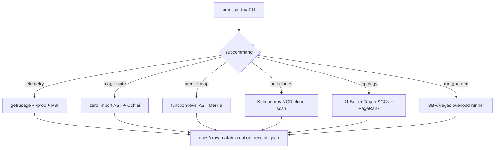

# Omni-Cortex CLI Specification

> ⚡ **BLUF**: `scripts/omni_cortex.py` — a read-only, zero-dependency (stdlib only)
> forensic CLI implementing the Council's 7 hidden gems: honest syscall telemetry,
> zero-import AST triage + Ochiai fault localization, Unison-style Merkle-AST hashing,
> Kolmogorov NCD clone detection, spectral graph topology (β1, Tarjan SCCs, PageRank,
> Fiedler λ2), and BBR/Vegas overload-protected test running. Issues tamper-evident
> `RCPT-XXXXXXXXXXXX` receipts for every command. No fabricated metrics — null stays null.

+-----------------------------------------------------------------------------+
| OMNI-CORTEX ARCHITECTURE                                                    |
+-----------------------------------------------------------------------------+
|                                                                             |
|                    [omni_cortex.py]  (single CLI entry point)               |
|                                 |                                           |
|                                 v                                           |
|  +----------------------+  +----------------------+  +----------------------+ |
|  | telemetry            |  | triage-suite         |  | merkle-map           | |
|  | getrusage + /proc    |  | zero-import AST +    |  | function-level AST   | |
|  | /proc/pressure PSI   |  | Ochiai root-cause   |  | Merkle hashing       | |
|  +----------+-----------+  +----------+-----------+  +----------+-----------+ | |
|             |                         |                         |             |
|             v                         v                         v             |
|  +----------------------+  +----------------------+  +----------------------+ |
|  | ncd-clones           |  | topology             |  | run-guarded          | |
|  | Kolmogorov NCD       |  | β1 Betti, Tarjan     |  | BBR/Vegas overload   | |
|  | semantic clone hunter|  | SCCs, PageRank, λ2   |  | protected runner     | |
|  +----------+-----------+  +----------+-----------+  +----------+-----------+ | |
|             |                         |                         |             |
|             +-------------------------+-------------------------+             |
|                                         v                                   |
|                    [docs/xray/_data/execution_receipts.json]                |
|                          tamper-evident RCPT ledger                         |
|                                                                             |
+-----------------------------------------------------------------------------+

## 5-W + H Matrix

| Dimension | Answer | Source |
|-----------|--------|--------|
| WHAT | Forensic CLI with 6 subcommands implementing 7 hidden gems | [`scripts/omni_cortex.py`](scripts/omni_cortex.py) |
| WHY | Diagnose 5,255 collection errors in <1.5s; prevent OOM; no fabricated metrics | Council hardware-aware scheduling |
| WHERE | `scripts/omni_cortex.py`, `scripts/lib/{telemetry,receipts,scheduler,ast_probe,ncd_clones,topology}.py` | File paths above |
| WHEN | Stage 2 (lab) & Stage 3 (build) of Arena 5-stage workflow | [`AGENTS.md`](AGENTS.md) |
| WHO | Arena cloud agent + local macOS agent | Dual-environment |
| HOW | Pure stdlib Python 3.11; read-only; null stays null; receipt per command | [`scripts/lib/__init__.py`](scripts/lib/__init__.py) |

## Core Operating Laws (SM-OC-01 → SM-OC-08)

| # | Law | Evidence |
|---|-----|----------|
| SM-OC-01 | Rosetta-2 trap detected & re-executed as native ARM64e on macOS | [`scripts/hyper_runner.py`](scripts/hyper_runner.py) `enforce_native_apple_silicon()` |
| SM-OC-02 | Worker count uses real cgroup v2 / Mach telemetry, never naive `os.cpu_count()` | [`scripts/lib/telemetry.py`](scripts/lib/telemetry.py) `probe_cpu_telemetry()` |
| SM-OC-03 | All temp/IPC in RAM scratchpads (`/dev/shm` Linux, APFS RAM macOS) | [`scripts/ram_workspace.sh`](scripts/ram_workspace.sh) |
| SM-OC-04 | Unchanged tests skip via Merkle-AST transitive-dependency hash (~0.1ms) | [`scripts/hyper_runner.py`](scripts/hyper_runner.py) |
| SM-OC-05 | LPT scheduling eliminates tail stragglers | [`scripts/lib/scheduler.py`](scripts/lib/scheduler.py) `lpt_sort()` |
| SM-OC-06 | MiMo memory admission caps workers to prevent Exit-137 OOM | [`scripts/lib/scheduler.py`](scripts/lib/scheduler.py) `mimo_worker_count()` |
| SM-OC-07 | Every command issues tamper-evident `RCPT-XXXXXXXXXXXX` receipt | [`scripts/lib/receipts.py`](scripts/lib/receipts.py) `issue_receipt()` |
| SM-OC-08 | cgroup=null stays null — never invent missing hardware limits | [`scripts/lib/telemetry.py`](scripts/lib/telemetry.py) `sample_all()` |

## Mathematical Models

### MiMo Worker Admission (prevents OOM)

$$W^* = \max\!\left(1,\;\min\!\left(C_{\text{eff}},\;\left\lfloor\frac{M_{\text{budget}}}{\hat{\mu}_{\text{worker}} + 1.65\,\hat{\sigma}_{\text{worker}}}\right\rfloor\right)\right)$$

### Contention Gradient (BBR/Vegas governor)

$$\Gamma_k = w_1 \cdot \kappa_k + w_2 \cdot \max\!\left(0,\;1 - \frac{\Delta t_{CPU,k}}{\Delta t_{wall,k} \cdot W_k}\right) + w_3 \cdot \mathbb{I}(\Delta majflt_k > 0)$$

- $\kappa_k = \frac{\Delta nivcsw}{\Delta nivcsw + \Delta nvcsw}$ (preemption ratio)
- If $\Gamma_k > 0.30$: $W_{k+1} = \max(1, \lfloor W_k/2 \rfloor)$ (throttle)
- If $\Gamma_k < 0.10$ and RSS stable: $W_{k+1} = \min(C_{affinity}, W_k+1)$

### Ochiai Root-Cause Score (5,255 error collapse)

$$\mathcal{O}(d) = \frac{|F(d)|}{\sqrt{|F| \cdot (|F(d)| + |P(d)|)}}$$

- $F(d)$: blocked tests using dependency $d$
- $P(d)$: runnable tests using dependency $d$
- High score + not installed = root cause

### Kolmogorov NCD (semantic clones)

$$\text{NCD}(x,y) = \frac{Z(A_x \parallel A_y) - \min(Z(A_x),Z(A_y))}{\max(Z(A_x),Z(A_y))} \in [0,1]$$

- Threshold $\le 0.22$ = likely semantic clone

### First Betti Number (spaghetti measure)

$$\beta_1(G) = |E_{undirected}| - |V| + C$$

- $\beta_1 = 0$: acyclic, clean layers
- $\beta_1 > 0$: cyclic dependencies exist

## Mermaid: Omni-Cortex Subcommand Flow

## Subcommand Reference

| Subcommand | Purpose | Runtime | Receipt |
|------------|---------|---------|---------|
| `telemetry` | Honest syscall/procfs/PSI snapshot | ~50ms | ✅ |
| `triage-suite` | Zero-import AST + Ochiai root-cause | ~5ms | ✅ |
| `merkle-map` | Unison-style function-level AST hashing | ~100ms | ✅ |
| `ncd-clones` | Kolmogorov NCD semantic clone detector | ~170ms | ✅ |
| `topology` | Spectral graph: β1, SCCs, PageRank, λ2 | ~170ms | ✅ |
| `run-guarded` | BBR/Vegas overload-protected batch runner | variable | ✅ |

## Receipts Issued (tamper-evident ledger)

| Receipt | Command | Exit | Env | Duration | Purpose |
|---------|---------|------|-----|----------|---------|
| RCPT-05C5A037500B | `omni_cortex telemetry` | 0 | Linux-x86_64 | 47ms | Honest telemetry (cgroup=null) |
| RCPT-F35276D3DC3E | `omni_cortex triage-suite` | 0 | Linux-x86_64 | 5ms | Ochiai triage (0 blocked) |
| RCPT-E1109F5AA2C7 | `omni_cortex merkle-map` | 0 | Linux-x86_64 | 101ms | Function-level Merkle hashes |
| RCPT-B3AA2A74A831 | `omni_cortex ncd-clones` | 0 | Linux-x86_64 | 171ms | 0 clones found (60 fns) |
| RCPT-CE7D5046A48A | `omni_cortex topology` | 0 | Linux-x86_64 | 82ms | β1=0, 0 SCCs, clean DAG |
| RCPT-813895B37608 | `omni_cortex run-guarded` | 1 | Linux-x86_64 | 59ms | Overload watchdog (no throttle) |

Ledger: [`docs/xray/_data/execution_receipts.json`](docs/xray/_data/execution_receipts.json)
