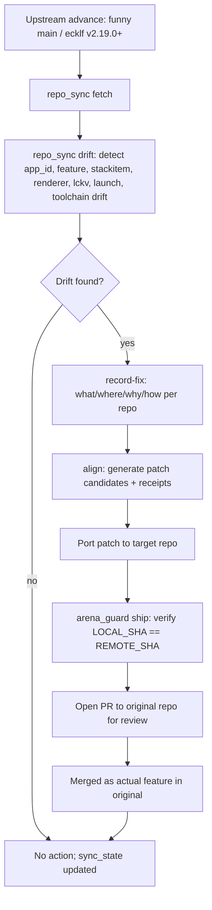
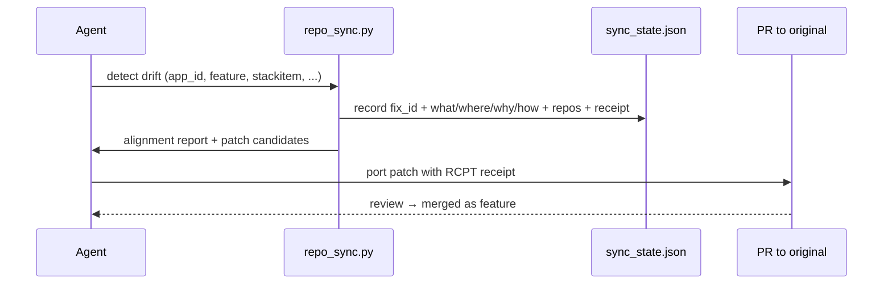

# Multi-Repo Sync Specification

> ⚡ **BLUF**: `scripts/repo_sync.py` + `scripts/repo_manifest.json` track advancements across the Luma webOS
> launcher ecosystem (SteveSpivak working branch → funnymataleao Rust base → ecklf/lg-luma original v2.19.0).
> Detects drift, aligns patches, records fix provenance (what/where/why/how), and issues tamper-evident RCPT
> receipts so agents across all environments stay synchronized and patches port cleanly to originals for review.

+-----------------------------------------------------------------------------+
| MULTI-REPO ECOSYSTEM                                                        |
+-----------------------------------------------------------------------------+
|                                                                             |
|  [ecklf/lg-luma]  v2.19.0 (TypeScript/Web)   <-- original upstream         |
|        | 25d342a                                                          |
|        v                                                                  |
|  [funnymataleao/luma-webos-launcher] v2.2.160 (Rust + OpenGL ES)           |
|        | 40994fc  (our base commit)                                        |
|        v                                                                  |
|  [SteveSpivak/luma-webos-launcher] arena/5fe14abb (our working branch)      |
|        | 1dc0ff69  (PR #2, Council framework applied)                        |
|        v                                                                  |
|  [Patches ported back] → PRs to funny → PRs to ecklf (review → features)   |
|                                                                             |
+-----------------------------------------------------------------------------+

## 5-W + H Matrix

| Dimension | Answer | Source |
|-----------|--------|--------|
| WHAT | Multi-repo patch alignment & drift detection across 3 repos | [`scripts/repo_sync.py`](scripts/repo_sync.py) |
| WHY | Keep patches aligned & working across all repos; remember what/where/why/how fixed; port to originals as features | Council cross-repo protocol |
| WHERE | `scripts/repo_manifest.json`, `docs/xray/_data/repo_sync/sync_state.json`, `docs/work-units/WU-*.md` | File paths above |
| WHEN | Before every patch port; on schedule (drift scan); after any upstream release | `repo_sync fetch/drift/align` |
| WHO | Arena cloud agent + local macOS agent + dev team | Dual-environment |
| HOW | `git ls-remote` read-only ref/tag fetch → drift detection → alignment report → fix provenance → receipt | [`scripts/repo_sync.py`](scripts/repo_sync.py) |

## Repo Registry

| Alias | Role | Remote | Branch | Language | Last Known |
|-------|------|--------|--------|----------|------------|
| steve | working_branch | SteveSpivak/luma-webos-launcher | arena/5fe14abb | Rust | `1dc0ff69` (PR #2 open) |
| funny | upstream_base | funnymataleao/luma-webos-launcher | main | Rust + OpenGL ES | `40994fc` (v2.2.160) |
| ecklf | original_upstream | ecklf/lg-luma | main | TypeScript/Web | `v2.19.0` (`25d342a`) |

## Core Operating Laws (SM-MR-01 → SM-MR-08)

| # | Law | Evidence |
|---|-----|----------|
| SM-MR-01 | Never modify production app ID `space.nuvio.webos` in any repo | [`repo_manifest.json`](scripts/repo_manifest.json) alignment_rules |
| SM-MR-02 | `space.nuvio.lab` only when `nuvio_lab` feature + `lab=true` | alignment_rules |
| SM-MR-03 | No silent runtime override of production app ID; invalid IDs fail validation | alignment_rules |
| SM-MR-04 | Rollback requires no production Nuvio application modification | alignment_rules |
| SM-MR-05 | No extra media launcher or duplicate routing layer | alignment_rules |
| SM-MR-06 | Every cross-repo patch carries a tamper-evident `RCPT-XXXXXXXXXXXX` receipt | alignment_rules |
| SM-MR-07 | Code changes in any repo require docs/xray/ sync in the same commit | alignment_rules |
| SM-MR-08 | Fix provenance records what/where/why/how per repo before porting | [`repo_sync.py record-fix`](scripts/repo_sync.py) |

## Drift Categories Tracked

| Category | What it detects | Repos affected |
|----------|----------------|----------------|
| app_id_divergence | `space.nuvio.webos` vs `space.nuvio.lab` mismatches | steve, funny |
| feature_gating_divergence | `nuvio_lab` feature presence/absence | steve, funny |
| stack_item_field_divergence | StackItem field sets (still_url, poster_url, etc.) | steve, funny |
| renderer_iflet_guard_divergence | `if let` guards rejected on Rust 1.93 CI | steve, funny |
| lckv_seqlock_divergence | `head == tail && even` seqlock violations | steve, funny |
| launch_guard_divergence | `!self.launching` duplicate-launch guard | steve, funny |
| ci_rust_toolchain_divergence | Rust toolchain pin (1.93 vs 1.96+) | steve, funny |

## Mermaid: Patch Porting Flow



## Mermaid: Fix Provenance Tracking



## Subcommand Reference

| Subcommand | Purpose | Runtime | Receipt |
|------------|---------|---------|---------|
| `fetch` | Read-only `git ls-remote` refs + tags from all 3 repos | ~2.7s | ✅ |
| `drift` | Detect app_id/feature/stackitem/renderer/lckv/launch/toolchain drift | ~0.1s | ✅ |
| `align` | Generate patch candidates + fix provenance + portability | ~0.1s | ✅ |
| `record-fix` | Record fix provenance: what/where/why/how per repo | instant | ✅ (passed in) |

## Recorded Fix Provenance

| Fix ID | What | Where | Why | How | Repos |
|--------|------|-------|-----|-----|-------|
| EL-006 | StackItem lacks Default; replaced `..Default::default()` with explicit fields | `src/tests.rs`, `src/main.rs` LUMA_GAME_PREVIEW | Compilation E0382 on Rust 1.93 | Explicit field init | steve, funny |
| EL-004 | `if let` guards experimental on Rust 1.93 CI pin | `src/renderer.rs:2033,1883` | CI 1.93.0 rejects guards | Rewrite guards or bump CI to 1.96+ | steve, funny |
| WU-001 | Council Arena OS: AGENTS.md + arena_guard.py + docs/xray KB | repo-wide | Prevent lost work in ephemeral containers; LOCAL_SHA == REMOTE_SHA | 5-stage loop + receipt ledger + pre-commit hook | steve, funny, ecklf |
| WU-002 | Omni-Cortex CLI: telemetry, Ochiai, Merkle-AST, NCD, spectral, BBR/Vegas | `scripts/omni_cortex.py`, `scripts/lib/*`, `labs/04-08/` | Cross-platform agent readiness; zero fabricated metrics | Pure stdlib Python 3.11, read-only, unprivileged syscalls | steve, funny, ecklf |

## Patch Portability Matrix

| Work Unit | Rust Required | Portable to funny | Portable to ecklf | Blocking |
|-----------|---------------|-------------------|-------------------|----------|
| WU-001 Council framework | No | ✅ | ✅ | None |
| WU-002 Omni-Cortex CLI | No | ✅ | ✅ | None |
| EL-006 StackItem Default fix | Yes | ✅ (Rust) | ❌ (TS/Web) | Rust toolchain |
| EL-004 if let guard fix | Yes | ✅ (Rust) | ❌ (TS/Web) | Rust toolchain |

## Cross-Env Usage

```bash
# 1. Fetch latest from all repos (read-only)
python3 scripts/repo_sync.py fetch

# 2. Detect drift since last sync
python3 scripts/repo_sync.py drift

# 3. Generate alignment report + patch candidates
python3 scripts/repo_sync.py align

# 4. Record a fix before porting
python3 scripts/repo_sync.py record-fix --fix-id <id> --what "..." --where "..." \
  --why "..." --how "..." --repos "steve,funny" --receipt "RCPT-..."

# 5. Port patch + ship with SHA parity
python3 scripts/arena_guard.py ship "feat: port <fix> to <repo>" --receipt "RCPT-..."
```
