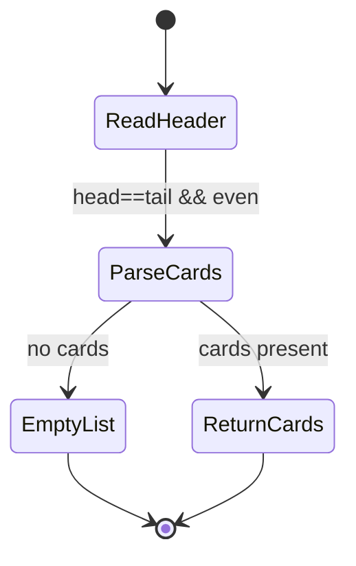
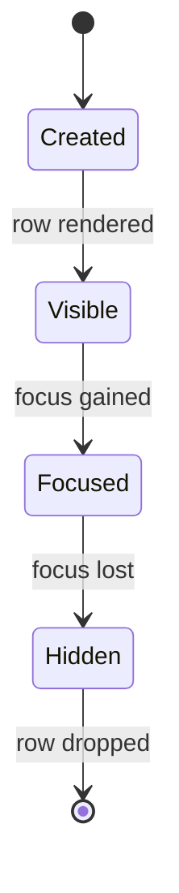

# Mermaid Diagrams

> ⚡ **BLUF**: Three architecture diagrams document the Nuvio launch flow,
> LCKV bridge lifecycle, and stack-item state machine. All use valid Mermaid
> syntax and are under 45 edge definitions each.

## Nuvio Deep-Link Launch Flow

```mermaid
flowchart TD
    A[User card click] --> B[Effect::NuvioLaunch]
    B --> C[validate_nuvio_target()]
    C --> D{nuvio_lab feature?}
    D -- yes --> E[appId = space.nuvio.lab]
    D -- no --> F[appId = space.nuvio.webos]
    E --> G[call("luna://com.palmdtv.applauncher/launch")]
    F --> G
    G --> H[Nuvio opens title]
```

## LCKV Bridge Lifecycle



## StackItem State Machine


