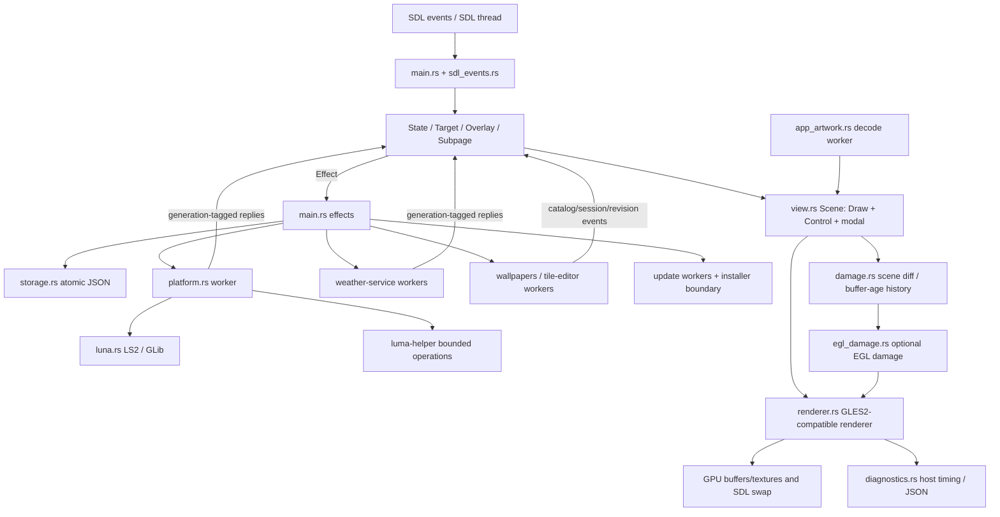

# Luma architecture and ownership audit

**Base:** `e5608cd053be5376a54a806129a332952dfabcef` (Luma 2.16.2). All source anchors below refer to this commit. This is a source audit, not a device trace. Native compilation/tests are BLOCKED.

## Verdict

Luma already has a coherent native state → scene → renderer architecture, substantial navigation safeguards, bounded worker interfaces and useful rendering diagnostics. Reuse those owners. There is no source-backed reason to introduce a browser runtime, a second navigation framework, another settings store or a device collector. Real video is not an existing Luma capability.

## Owner ledger

| Responsibility | Authoritative owner and source anchors | Boundary / reuse decision |
|---|---|---|
| Process startup, SDL context, event loop | `src/main.rs:575–869, 968–1935` | Keep input, state composition and GL submission on SDL thread. Desktop requests GL 3.2; TV requests GLES2 (`739–753`). |
| Event decoding / Back | `src/sdl_events.rs:1–61`; `src/main.rs:204–291, 1355–1510` | Preserve raw webOS keycodes before rust-sdl2 enum conversion; short Back versus 600 ms hold and cancellation already exist. |
| Mutable application state | `src/state.rs:209–295` | One `State`; no parallel UI store. `Target`, `Overlay`, `Subpage`, `Effect` are explicit (`39–201`). |
| Focus and hit testing | `src/state.rs:548–829, 1031–1558`; `src/view.rs:231–238, 781–891` | Controls are generated with the scene; reverse-order hit testing and viewport clipping already protect fixed toolbars. Pointer focus deliberately does not reveal-scroll. |
| Scene construction | `src/view.rs:163–278, 504–700` | `Scene { draw, controls, modal }` is the native equivalent of a scene graph. Add presentation through `Draw`, not DOM/CSS. |
| Cards / shared artwork | `src/view.rs:781–980`; `src/branding.rs`; `src/app_artwork.rs` | Home, Apps and Recents reuse `app_face`. Face geometry and caption-inclusive hit geometry are intentionally distinct. |
| Recents | `src/recents.rs`; `src/recents-view.rs:5–159` | System history, not favorites or a process-kill API. Depth-sorted painting and controls share geometry; exiting cards are not hit targets. |
| Settings | `src/state.rs:969–1030, 1921–2540`; `src/view.rs:2094–2650` | Four sections: Interface, Background, Widgets, System. Explicit parent restoration and sidebar breadcrumbs already exist. |
| Preferences | `src/model.rs:215–431`; `src/storage.rs:7–243` | `serde(default)` supplies missing fields; sanitization is explicit. Atomic private temporary file + sync + rename; corrupt JSON is an error, not silent default overwrite. |
| Platform / Home identity | `src/platform.rs:14–173, 175–380`; `src/luna.rs`; `tv-helper/` | Protected boundary. Normal app identity is `com.ecklf.luma`; existing staged/replacement Home paths are not changed by this audit. |
| Installed artwork | `src/app_artwork.rs:24–29, 127–174, 419–692` | File reads and decode on worker; GPU upload on SDL thread. Version/path-aware source keys, token invalidation, visible priority, 16 request slots, 8 prefetch slots. |
| Companion pages | `src/companion.rs`; `src/wallpapers.rs`; `src/tile-editor.rs` | Browser files are only the phone/computer companion UI, not Luma's launcher renderer. One selected private/link-local IPv4 interface; random capability token; cancellation generations. |
| Weather / webhooks / updates | `src/weather-service.rs`; `src/webhook.rs`; `src/update.rs` | Network off SDL thread; fixed weather origins, bounded replies, generation checks. Update feed/package constraints and checksum verification are existing functionality. |
| Rendering | `src/renderer.rs:19–185, 327–565, 706–1549` | Retained logical layout; generated paint vertices and cached vector/text meshes. No video draw primitive or decoder owner. |
| Damage | `src/damage.rs`; `src/egl_damage.rs`; `src/main.rs:1726–1794` | Command diff + four-entry age history; unknown age/full state changes fail conservatively to full redraw. EGL symbols resolved only from already-loaded EGL. |
| Observability | `src/diagnostics.rs`; `src/main.rs:1878–1934` | Reuse JSON diagnostics. It is not a GPU timer, input-latency probe, GPU-memory readout or physical-TV measurement in this workspace. |

## Existing state/reply safety

- Inventory replies replace apps; input-only replies preserve apps/artwork/preferences. Failed initial inventory retries five times at two-second spacing, then exposes an error; it never substitutes desktop demo apps on TV (`state.rs:631–694`, `platform.rs:208–257`).
- Input snapshots wait for interaction release and yield to a newer complete inventory (`input-refresh.rs:16–54`, `main.rs:1660–1674`).
- Recents and companion sessions carry generations; artwork carries request tokens; weather carries latest-job generations. Do not replace these with a generic unrestricted event bus.
- Modal scene construction clears underlying controls (`view.rs:625–647`). Recents restores parent controls immediately on dismissal while its outgoing visuals fade (`674–697`).
- Home return commits keyboard edits before clearing subpages (`state.rs:439–450`). Existing tests cover this and stale Recents replies, but were not executed here.

## Native integration / forensic boundary

- `luna.rs` links `luna-service2` and `glib-2.0`, uses a worker-owned GLib context and bounded 2 MiB replies. It does not justify impersonating another app.
- `webos-compat.rs` reads real `/proc/self/auxv` values for the SDK's missing `getauxval`; it does not invent CPU features.
- `tools/webos-runtime.mjs:8–35` pins SDL-webOS archive/library SHA-256 and checks ARM soft-float ELF/backend markers. **The binary is absent here; pin inspection is not binary verification.**
- `tools/build-webos.sh` pins the ARM gnueabi/sysroot/pkg-config approach and Cortex-A9 flags. No cross-build was run.
- Actual TV ELF `DT_NEEDED`, symbol versions, hashes, loaded maps and media APIs are UNKNOWN. The firmware snapshot explicitly says ELF headers are not dynamic-dependency evidence. Obtain those only in a later authorized read-only device session.

## Highest-value findings

1. **Missing execution evidence, not missing architecture:** 334 static Rust `#[test]` attributes were indexed; none is claimed to pass. See `../audit/test-inventory.json`.
2. **CPU decode asymmetry:** installed icons decode off-thread, but ordinary images/wallpapers use `image::open` in the renderer (`renderer.rs:995–1015`). First-use wallpaper decode/upload can block SDL; prewarm mitigates rather than removes this.
3. **Soft, not hard, cache ceilings:** eviction skips current-frame entries. Vector meshes have no aggregate cache budget. See `rendering-performance.md`.
4. **Diagnostics need extension before a performance verdict:** p95 exists; p99 can be derived from the timeline; input-to-visible, idle wakeups, process-memory slope and GPU timing are absent.
5. **No real-video owner:** adding decoded frames to `Draw` would create a new media lifecycle, not just a new card background. Keep it outside the UI experiment.
