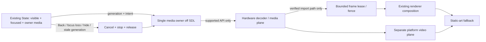

# Real-video feasibility and media-plane assessment

## Verdict

**Static launcher artwork: implemented. Real video inside Luma: not implemented and BLOCKED at the platform-API/evidence gate. Separate supported playback app: the lowest-risk existing route.** No decoder, video texture, hardware overlay, media-plane control or protected-media integration was added or tested.

Luma's `Draw` enum supports shapes, text, raster images, installed artwork, clipping and fades—not video (`renderer.rs:63–76`). `Platform::Request::Launch` delegates to the application manager (`platform.rs:326–351`). A launcher can hand off to a player without owning its decoder, audio, DRM or video plane.

## What is and is not established

- Luma owns an SDL/GLES graphics surface. TV code requires the SDL-webOS Wayland backend and sets its surface identity before video initialization (`main.rs:608–647, 722–735`).
- `development.md:518–575` documents a historical C5 graphics-plane investigation and explicitly separates 1080p graphics from separate-plane 4K video. Its compositor mutation is **not** an approved procedure here and was not repeated.
- A 4K screenshot/drawable does not prove 4K panel presentation. The documented forced-4K compositor test produced corruption; that does not prove all LG graphics/video paths are incapable.
- The bundled firmware README describes one static specimen. It contains no firmware binaries; ELF header inventory is not `DT_NEEDED`, QML names are not behavior, and regex matches are capped. It cannot establish the owner's loaded libraries or callable media APIs.
- The LG dependency snapshot marks streaming DRM dependencies UNKNOWN. No protected stream interception, transform, bypass or service disabling is permitted.

## Option matrix

| Option | Native work / ownership | Benefits | Risks and missing proof | Recommendation |
|---|---|---|---|---|
| Static artwork / existing crossfades | Existing `Draw`, artwork worker and damage | No decoder/audio/media-plane lifecycle; bounded existing caches | First-use wallpaper decode still on SDL; no motion content | Keep baseline |
| Short predecoded animation in GL | New decode/format scheduler, frame queue, clock, cancellation, texture reuse, damage and memory budgets | Could stay in graphics surface if explicitly approved later | CPU decode/copy/upload cost, tearing/stale frames, cache pressure; no codec/API proof; not equivalent to hardware video | Defer; do not disguise as real-video support |
| Launch separate supported playback app | Existing application-manager launch; player owns media | Reuses platform decoder/audio/DRM and recovery; smallest Luma change | Return focus/Back and app availability need device validation; no inline hero | Preferred real-video route |
| Hardware decoder + separate overlay/media plane | New platform media owner below/alongside SDL graphics | Potential efficient full-rate video and separate 4K path | Exact service/API, permissions, z-order, holes/transparency, crop, audio, suspend/resume and lifetime are UNKNOWN | Research only after explicit approval |
| Hardware decoder → imported GPU texture | Decoder/exporter + EGLImage/DMABUF or proven equivalent + GLES synchronization | Inline native composition if supported | Export/import formats/modifiers, fences, copies, lifetime, bandwidth and memory unknown; GL texture upload alone is not zero-copy | BLOCKED until API and copy proof |
| Software decoder → RGBA upload | New decoder and bounded frame pipeline | Useful controlled desktop experiment with owner-owned media only | Full-frame CPU/GPU traffic; likely poor embedded margin; no TV performance inference | Not a shipping proposal |

## Proposed architecture, not implementation

Only one of the plane or texture routes should be selected after evidence. Do not create both owners. The media owner must not take over SDL input, Home identity, system audio or protected app services. A mounted/loading request is not playback; require actual frame progress and visibility. Every asynchronous result needs a generation and cancellation path.

## Memory/bandwidth arithmetic, explicitly hypothetical

Three 1920×1080 RGBA buffers are 23.73046875 MiB; three 3840×2160 buffers are 94.921875 MiB. Three NV12 payloads are 8.90625 and 35.625 MiB respectively. These exclude decoder workspaces, alignment, reference frames, GPU copies, fences, compositor buffers and audio. They are **not measured memory or a decoder requirement**.

At 60 Hz, one full 1080p RGBA read plus upload is about 497.66 MB/s in each direction before rendering; 4K is about 1.99 GB/s each way. This decimal-bandwidth calculation is a reason to demand a zero-copy/overlay proof, not a claim about the TV's available bandwidth. No real-video code is justified by arithmetic alone.

## Approval-gated falsification plan

**Preconditions:** separate owner approval; exact model/firmware identity; verified independent recovery; Home/remote/LAN health; owner-owned unprotected fixture; no system configuration changes. Unknown recovery means NOT-READY.

1. **Read-only API/library census:** record authorized ELF dynamic dependencies/symbol versions and SHA-256, loaded maps, public SDK headers and service permissions. Hash before interpretation; redact identifiers. A filename or exported symbol alone does not prove a usable call path.
2. **Separate-player control:** launch a supported player with the owner fixture; verify playback, audio, Back/return focus, Home, suspend/resume and streaming-app launch afterward. This tests handoff, not inline video.
3. **Minimal media-plane probe, only after API approval:** one owner-owned stream, explicit start/stop, static fallback, no UI rewrite. Record actual plane/crop/z-order, frame progress, audio ownership and cleanup. Fail if it obscures Home, steals Back, leaks a plane or survives focus loss.
4. **Texture-import probe only if documented and permitted:** prove format/modifier/fence support and count copies. Reject if it falls back to full-frame CPU readback/upload or cannot bound leases/memory.
5. **Compare with static baseline:** identical UI/assets/refresh, forced-navigation and true-idle runs separately; A/B/B/A cycles; p95/p99 intervals, input-to-visible-call latency, frame progress, RSS/PSS where available, wakeups and cleanup. GPU memory stays UNKNOWN without a trustworthy readout.
6. **Stop conditions:** any protected-app regression, media-plane leak, focus/Back loss, unbounded queue, unsupported import, protected-content access or missing recovery. Restore only the experiment's own process/state; do not mutate firmware/DNS/services.

No step above was run. Physical-TV feasibility and performance remain **NOT_RUN**.
