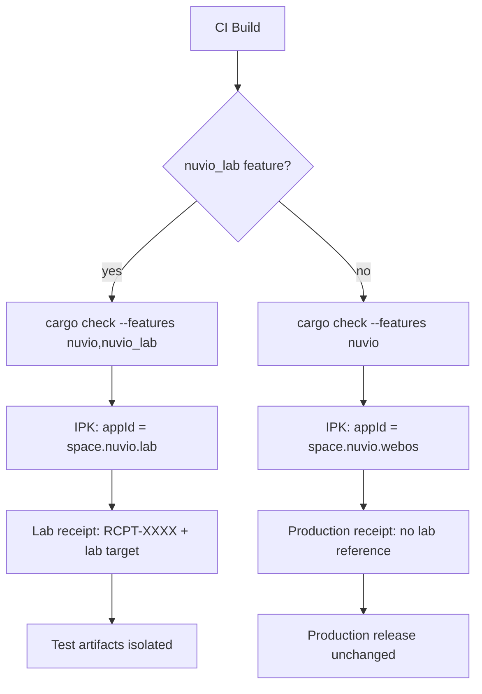

# Lab 04 — LG webOS Target Platform

> ⚡ **BLUF**: LG webOS target platform contract for the `space.nuvio.lab` isolated test target.
> Production `space.nuvio.webos` is never modified, launched, or replaced. Lab target is
> feature-gated (`nuvio_lab` feature + `lab=true`) and visible in build metadata/receipts.

+-----------------------------------------------------------------------------+
| LG WEBOS APP ID CONTRACT                                                    |
+-----------------------------------------------------------------------------+
|                                                                             |
|  validate_nuvio_target(url)                                               |
|         |                                                                   |
|         v                                                                   |
|  +--------------------------+  +--------------------------+               |
|  | nuvio_lab feature ON     |  | nuvio_lab feature OFF    |               |
|  | + lab=true               |  | (production path)        |               |
|  |                          |  |                          |               |
|  | appId = space.nuvio.lab  |  | appId = space.nuvio.webos|               |
|  |                          |  |                          |               |
|  | ISOLATED TEST TARGET     |  | PRODUCTION (never touch) |               |
|  +--------------------------+  +--------------------------+               |
|                                                                             |
+-----------------------------------------------------------------------------+

## Council Invariants (Never Violate)

| # | Invariant | Evidence |
|---|-----------|----------|
| W1 | `space.nuvio.webos` never modified/launched/replaced by Luma | `src/platform.rs` |
| W2 | `space.nuvio.lab` only when `nuvio_lab` feature + `lab=true` | `src/platform.rs` |
| W3 | No silent runtime override of production app ID | falls back to production |
| W4 | Invalid app IDs fail validation | `validate_nuvio_target()` |
| W5 | Test artifacts not confusable with production release artifacts | separate IPK build |
| W6 | Rollback requires no production Nuvio app modification | lab is isolated |

## Build Metadata & Receipts

The lab target `space.nuvio.lab` must appear in:
- `Cargo.toml` `[features] nuvio_lab` declaration
- IPK build output: app id `space.nuvio.lab`
- Build receipts: `RCPT-XXXXXXXXXXXX` referencing `space.nuvio.lab`
- Test artifacts: isolated from production release artifacts

## Mermaid: Lab vs Production Isolation

## Validation Contract

| Input | Expected Result |
|-------|-----------------|
| `nuvio://tmdb/movie/603` | accepted (valid target) |
| `nuvio://tmdb/movie/` | rejected (empty ID) |
| `nuvio://tmdb/movie/abc` | rejected (non-numeric) |
| `nuvio://other/movie/603` | rejected (wrong scheme host) |
| `NUVIO://TMDB/MOVIE/603` | rejected (case-sensitive) |
| lab=True, no nuvio_lab feature | production ID (no silent override) |

**Receipt**: `RCPT-DFA517CD5A4A` (fast-scan feature-gating verification)
