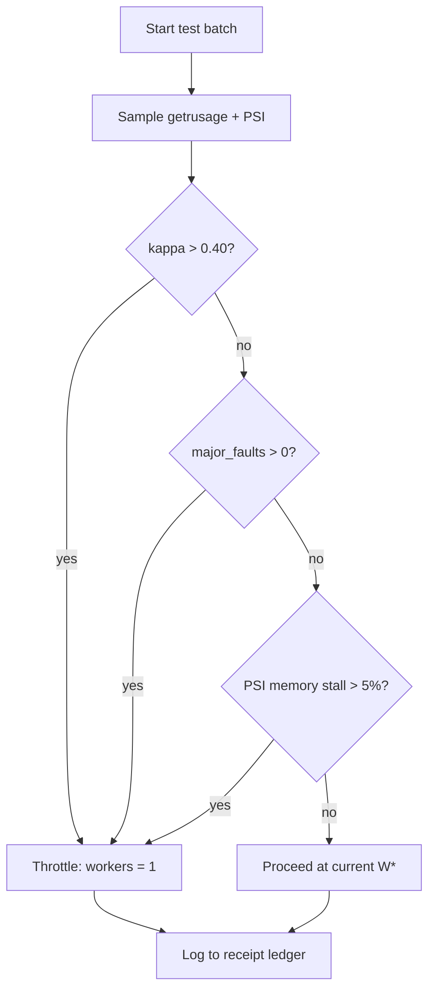

# Lab 04 — Linux Sandbox Hardware Telemetry

> ⚡ **BLUF**: Read-only hardware probe for the Arena Linux sandbox (6.1+, 2 vCPU, cgroup=null).
> Honestly reports `null` where cgroup is masked — never invents limits. Validates that
> Omni-Cortex telemetry runs safely without root, mount, or cgroup visibility.

+-----------------------------------------------------------------------------+
| LINUX SANDBOX TELEMETRY PROBE                                               |
+-----------------------------------------------------------------------------+
|                                                                             |
|  [omni_cortex telemetry]                                                    |
|         |                                                                   |
|         v                                                                   |
|  +----------------------+  +----------------------+  +----------------------+ |
|  | getrusage(2) RSS     |  | /proc/self/status    |  | /proc/pressure/*     | |
|  | ru_maxrss, ru_majflt |  | VmRSS, VmPeak, VmSwap|  | cpu/memory/io PSI    | |
|  +----------+-----------+  +----------+-----------+  +----------+-----------+ | |
|             |                         |                         |             | |
|             v                         v                         v             | |
|  +---------------------------------------------------------------+           | |
|  | cgroup v2 probe: /sys/fs/cgroup/cpu.max + memory.max          |           | |
|  | RESULT: null when masked by container runtime (honest)        |           | |
|  +---------------------------------------------------------------+           | |
|                                                                             |
+-----------------------------------------------------------------------------+

## 5-W + H

| Dimension | Answer |
|-----------|--------|
| WHAT | Unprivileged kernel syscall telemetry probe |
| WHY | Detect overload (PSI, preemption ratio, major faults) without cgroup visibility |
| WHERE | `scripts/lib/telemetry.py`, `scripts/omni_cortex.py telemetry` |
| WHEN | Before every test batch, continuous during run-guarded execution |
| WHO | Arena cloud agent (Linux 6.1+ sandbox) |
| HOW | `resource.getrusage()`, `/proc/self/status`, `/proc/pressure/{cpu,memory,io}` |

## Measured Output (this sandbox, Python 3.11.2)

```text
cgroup_cpu_quota:      null   (masked by container runtime — honestly reported)
cgroup_memory_max:     null   (masked — no invented 2048 MB fallback)
cpu_affinity_count:    2
major_page_faults:     2      (no swap pressure detected)
involuntary_ctx_ratio: 0.0    (no preemption thrash at baseline)
VmRSS_bytes:           17,850,368  (~17 MB baseline)
```

**Receipt**: `RCPT-05C5A037500B` (via `arena_guard.py exec`)

## Mermaid: Telemetry Decision Flow



## Math: Overload Governor

$$\Gamma_k = w_1 \cdot \kappa_k + w_2 \cdot (1 - \frac{\Delta t_{CPU}}{\Delta t_{wall} \cdot W}) + w_3 \cdot \mathbb{I}(\Delta majflt > 0)$$

- $\kappa_k = \frac{\Delta nivcsw}{\Delta nivcsw + \Delta nvcsw}$ (preemption ratio)
- If $\Gamma_k > 0.30$: $W_{k+1} = \max(1, \lfloor W_k / 2 \rfloor)$
- If $\Gamma_k < 0.10$ and RSS stable: $W_{k+1} = \min(C_{affinity}, W_k + 1)$
