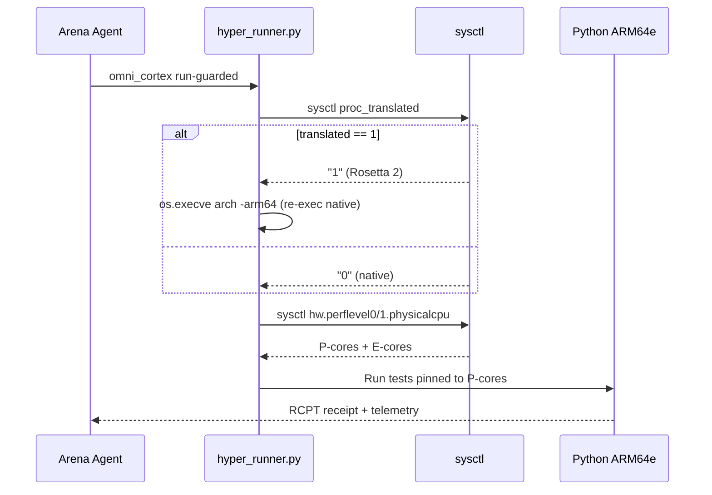

# Lab 04 — macOS M1 Pro Hardware Telemetry

> ⚡ **BLUF**: Platform-specific telemetry probe for macOS Apple Silicon M1 Pro.
> Detects Rosetta-2 x86 emulation trap, reads Mach P/E-core counts, and maps
> Unified Memory pressure. Auto-re-executes natively on ARM64e if stuck under Rosetta 2.

+-----------------------------------------------------------------------------+
| MACOS M1 PRO TELEMETRY PROBE                                                |
+-----------------------------------------------------------------------------+
|                                                                             |
|  [sysctl sysctl.proc_translated]  == 1?                                     |
|         | yes                                               | no          |
|         v                                                     v           |
|  [os.execve /usr/bin/arch -arm64]                    [Continue native]   |
|    [re-exec Python on ARM64e]                                                |
|                                                                             |
|  [sysctl hw.perflevel0.physicalcpu]  -->  P-cores (Firestorm)              |
|  [sysctl hw.perflevel1.physicalcpu]  -->  E-cores (Icestorm)               |
|  [vm_stat]                             -->  free+inactive+speculative pages|
|                                                                             |
+-----------------------------------------------------------------------------+

## 5-W + H

| Dimension | Answer |
|-----------|--------|
| WHAT | Rosetta-2 guard + Mach telemetry + Unified Memory probe |
| WHY | Prevent 35–45% speed loss from x86 emulation; pin to P-cores |
| WHERE | `scripts/lib/telemetry.py` (Darwin branch), `scripts/hyper_runner.py` |
| WHEN | Start of every Omni-Cortex run on macOS |
| WHO | Local macOS agent (M1 Pro MacBook) |
| HOW | `sysctl`, `os.execve("/usr/bin/arch", ...)`, `vm_stat` |

## Rosetta-2 Trap Detection (SM-HR-01)

```text
+-------------------------------------------------------------------------+
| TRAP DETECTION LOGIC                                                    |
+-------------------------------------------------------------------------+
|                                                                         |
|  translated = sysctl("sysctl.proc_translated")                          |
|                                                                         |
|  if translated == "1" && !HYPER_ROSETTA_REEXEC:                         |
|      env["HYPER_ROSETTA_REEXEC"] = "1"                                  |
|      os.execve("/usr/bin/arch",                                         |
|                ["/usr/bin/arch", "-arm64", sys.executable] + argv, env) |
|                                                                         |
|  # Now running native ARM64e on Firestorm P-cores                       |
+-------------------------------------------------------------------------+
```

## Worker Sizing (MiMo Equation on M1 Pro)

$$W^* = \max(1, \min(N_{P} + \lfloor 0.5 \cdot N_{E} \rfloor, \lfloor M_{budget} / (\\mu + 1.65\\sigma) \rfloor))$$

- M1 Pro: typically 6–8 P-cores + 2 E-cores → $C_{eff} \approx 7\text{--}9$
- E-cores weighted at 0.5 for compute-heavy test queues
- Never spawn on E-cores for CPU-bound test work

## Mermaid: M1 Pro Execution Path


