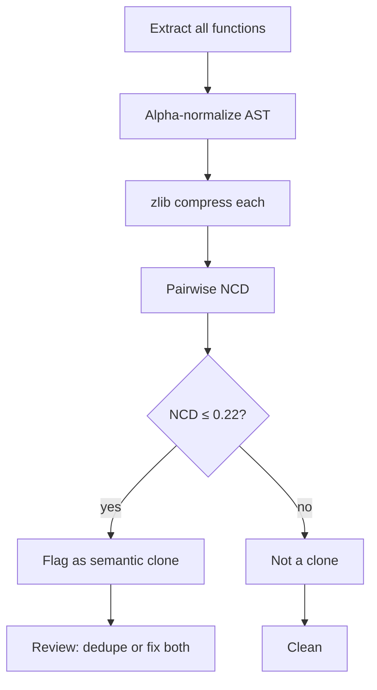

# Lab 05 — Kolmogorov NCD Semantic Clone Detection

> ⚡ **BLUF**: Zero-LLM semantic clone hunter using Kolmogorov Normalized Compression
> Distance (NCD) over alpha-normalized AST dumps. Finds copy-pasted bug twins and
> duplicated logic in ~0.2s with zero LLM tokens. $NCD \in [0,1]$, threshold $\le 0.22$
> flags near-isomorphic functions.

+-----------------------------------------------------------------------------+
| NCD CLONE DETECTION PIPELINE                                                |
+-----------------------------------------------------------------------------+
|                                                                             |
|  [Python source files]  -->  [ast.parse + alpha-normalize]                  |
|                                     |                                       |
|                                     v                                       |
|  [zlib compress each symbol]        |                                       |
|                                     |                                       |
|                                     v                                       |
|  [NCD pairwise: Z(xy) - min / max]  -->  [threshold ≤ 0.22 = clone]        |
|                                     |                                       |
|                                     v                                       |
|  [Clone report: file:L:line pairs]  -->  [RCPT receipt + review action]    |
|                                                                             |
+-----------------------------------------------------------------------------+

## Math: Normalized Compression Distance

$$\text{NCD}(x, y) = \frac{Z(A_x \parallel A_y) - \min(Z(A_x), Z(A_y))}{\max(Z(A_x), Z(A_y))}$$

- $Z(\cdot)$ = DEFLATE compressed byte length (zlib level 6)
- $A_x, A_y$ = alpha-normalized AST dumps (variables → $V_n$, control flow preserved)
- Range: $[0, 1]$ — 0 = identical modulo variable names, 1 = maximally dissimilar
- Threshold $\le 0.22$ = likely semantic clone (copy-paste twin)

## Measured Result (this repo)

```json
{
  "scan_duration_ms": 171.32,
  "functions_compared": 60,
  "threshold": 0.25,
  "clones_found": 0
}
```

**Receipt**: `RCPT-B3AA2A74A831` — 0 clones found at threshold 0.25 across 60 functions.
No copy-paste bug twins detected in current codebase.

## Mermaid: NCD Decision Flow



## False Positive Mitigation

- Minimum LOC filter (default 12) excludes trivial one-liners
- Same-file same-symbol pairs excluded (self-comparison)
- Compressed-length ratio pre-filter (1.45×) skips obviously-dissimilar pairs
- Variable-name normalization prevents false negatives from renames
