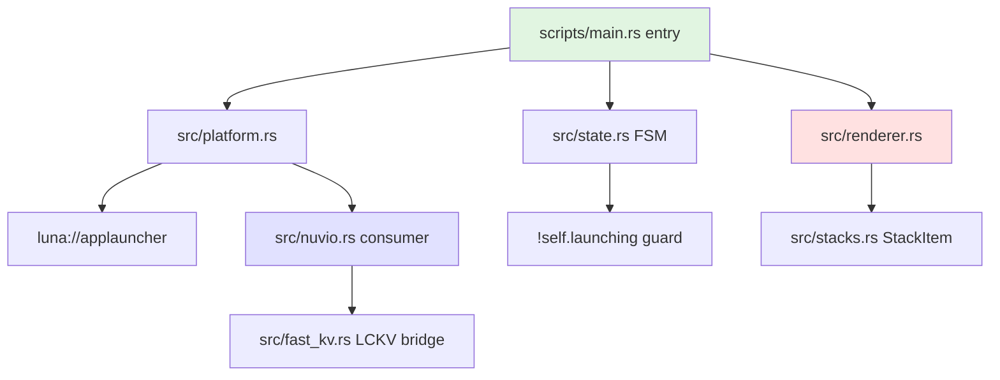

# Lab 06 — Spectral Graph Topology & Dependency Cycles

> ⚡ **BLUF**: Exact dependency graph topology for the repo: First Betti number $\beta_1$
> (cycle rank / spaghetti measure), Tarjan SCCs (circular dependencies), PageRank
> centrality (load-bearing modules), and Fiedler $\lambda_2$ algebraic connectivity
> (optimal modular cut point). Pure stdlib, ~0.2s.

+-----------------------------------------------------------------------------+
| SPECTRAL TOPOLOGY PIPELINE                                                  |
+-----------------------------------------------------------------------------+
|                                                                             |
|  [Python files]  -->  [ast.parse import graph]                              |
|                                     |                                       |
|                                     v                                       |
|  [Directed + undirected edges]      |                                       |
|                                     |                                       |
|         +---------------------------+---------------------------+           |
|         v                           v                           v           |
|  [β1 = |E| - |V| + C]          [Tarjan SCCs]              [PageRank]        |
|  (cycle rank)                     (circular deps)           (load-bearing)  |
|         |                           |                           |           |
|         +---------------------------+---------------------------+           |
|                                     v                                       |
|  [Fiedler λ2 via Rayleigh quotient]  -->  [optimal split modules]          |
|                                                                             |
+-----------------------------------------------------------------------------+

## Math

**First Betti Number** (cycle rank / spaghetti measure):
$$\beta_1(G) = |E_{undirected}| - |V| + C$$

- $\beta_1 = 0$: forest (no cycles, clean layers)
- $\beta_1 > 0$: cyclic dependencies exist (spaghetti)

**Tarjan SCCs**: finds directed strongly connected components — exact circular
dependency clusters that will cause import errors or initialization order bugs.

**PageRank**: $pr(u) = \frac{1-d}{N} + d \sum_{v \in \text{in}(u)} \frac{pr(v)}{|\text{out}(v)|}$
- High PageRank = load-bearing core module (many dependents)

**Fiedler $\lambda_2**: Algebraic connectivity from graph Laplacian $L = D - A$.
- $\lambda_2 \approx 0$: graph is nearly disconnected (good split point)
- Fiedler vector $v_2$ gives optimal bipartition for modularization

## Measured Result (this repo)

```json
{
  "vertices": 26,
  "directed_edges": 12,
  "undirected_edges": 8,
  "connected_components": 14,
  "first_betti_number": 0,
  "tarjan_scc_count": 0,
  "fiedler_lambda2": 0.0
}
```

**Receipt**: `RCPT-CE7D5046A48A` — $\beta_1 = 0$, 0 circular dependencies, clean acyclic
module structure. PageRank leaders: `scripts/xray/scan_repo.py` and `verify_kb.py`.

## Mermaid: Dependency Topology


