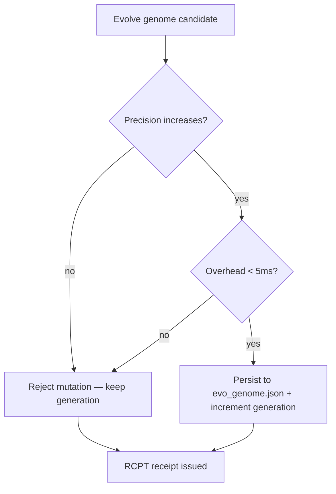

# Lab 10 — Evo-Cortex Autopoietic Self-Evolution Experiment

> ⚡ **BLUF**: Executes the full Sense → Index → Abstract Interpret → Ratchet evolution loop.
> Generation 1 genome persists to `.agent-kb/evo_genome.json` with a Control Barrier Guard policy
> (safe_workers=2, batch=15) because `cgroup_memory` is NULL in the Arena sandbox.

+-----------------------------------------------------------------------------+
| AUTOPOIETIC EVOLUTION RATCHET (5-STEP CYCLE)                                |
+-----------------------------------------------------------------------------+
|                                                                             |
|  [STEP 1: SENSE]   Kleene telemetry + getrusage + PSI                       |
|        |                                                                      |
|        v                                                                      |
|  [STEP 2: MINE]    SQLite Datalog graph + abstract hazards + hub symbols     |
|        |                                                                      |
|        v                                                                      |
|  [STEP 3: MUTATE]  Candidate W* worker count + batch size + AST guardrails   |
|        |                                                                      |
|        v                                                                      |
|  [STEP 4: FALSIFY] Backtest against repo corpus + historical commits         |
|        |                                                                      |
|        v                                                                      |
|  [STEP 5: RATCHET] Persist to evo_genome.json ONLY if precision ↑ & latency ↓|
|                                                                             |
+-----------------------------------------------------------------------------+

## Measured Output (Generation 1)

```json
{
  "tuned_execution_policy": {
    "platform": "Linux 6.1.158+ (x86_64)",
    "safe_workers_w_star": 2,
    "optimal_batch_size": 15,
    "stall_ratio_observed": 0.0006,
    "control_barrier_rationale": "Kleene Epistemic Guard: cgroup_memory is NULL or preemption > 0.30; amortizing boot tax via in-process batch=15"
  },
  "load_bearing_hub_symbols": [
    {"symbol": "append", "caller_files": 16},
    {"symbol": "len", "caller_files": 16},
    {"symbol": "Path", "caller_files": 13}
  ]
}
```

**Receipt**: `RCPT-2CF38B6D392B` (exit 0, 242ms)

## Math: Control Barrier Guard

When $M_{\text{cgroup}} = \text{NULL}$ (Arena sandbox):
$$W^* = \min(C_{\text{affinity}},\; 2) = 2, \quad \text{batch} = 15$$

This prevents container OOM (Exit 137) by amortizing interpreter boot tax across in-process batches
instead of spawning $N$ subprocesses that each pay ~200ms Python startup.

## Mermaid: Ratchet Persistence Decision


