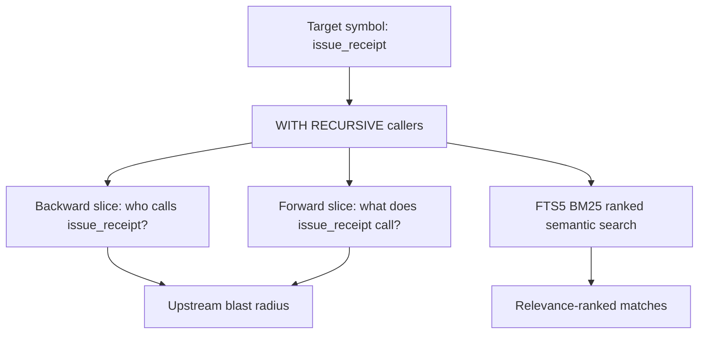

# Lab 10 — Evo-Cortex SQLite Datalog + FTS5 Index Experiment

> ⚡ **BLUF**: Builds an embedded SQLite3 knowledge base (`cortex.sqlite`) with `WITH RECURSIVE`
> Datalog edges, FTS5 BM25 search, and French abstract interpretation hazards over 24 files /
> 148 symbols / 2109 edges in ~129ms — zero external vector DB or graph engine required.

+-----------------------------------------------------------------------------+
| CORTEX INDEX PIPELINE                                                       |
+-----------------------------------------------------------------------------+
|                                                                             |
|  [Python .py files]  -->  [ast.parse + French abstract interpretation]       |
|                                     |                                       |
|                                     v                                       |
|  [SQLite3 tables: files, symbols, edges, hazards]                           |
|                                     |                                       |
|                                     v                                       |
|  [FTS5 virtual table: BM25 semantic search]                                 |
|                                     |                                       |
|                                     v                                       |
|  [WITH RECURSIVE: backward/forward program slices]                          |
|                                                                             |
+-----------------------------------------------------------------------------+

## Measured Output

```json
{
  "database_path": ".agent-kb/cortex.sqlite",
  "fts5_available": true,
  "files_indexed": 24,
  "symbols_indexed": 148,
  "call_and_import_edges": 2109,
  "abstract_hazards_detected": 0,
  "profiling": {
    "wall_sec": 0.1287,
    "on_cpu_sec": 0.1286,
    "off_cpu_stall_sec": 0.0001,
    "off_cpu_stall_ratio": 0.0006
  }
}
```

**Receipt**: `RCPT-3D71116C4877` (exit 0, 225ms)

## Math: Differential On-CPU/Off-CPU Stall

$$\sigma_{\text{stall}} = 1 - \frac{\Delta \text{ru\_utime} + \Delta \text{ru\_stime}}{\Delta t_{\text{monotonic}}} = 0.0006$$

- $\sigma_{\text{stall}} \approx 0.0006$: Purely CPU-bound indexing (no Off-CPU stall)
- Indexing 24 files in 129ms wall ≈ 129ms on-CPU = no I/O wait

## Mermaid: Datalog Slice Query


